# papple2

**A small Apple II emulator written in Python, built as a debugging instrument rather than a player.**

---

## Contents

- [Vision](#vision)
- [The games](#the-games)
- [The workbench](#the-workbench)
- [Architecture](#architecture)
- [Relation to sibling projects](#relation-to-sibling-projects)
- [Testing strategy](#testing-strategy)
- [Data files](#data-files)
- [Scripts & Experiments](#scripts--experiments)
- [Running](#running)

---

## Vision

`papple2` is a small Apple II emulator written in Python. It is not meant to compete with full emulators on speed or completeness. Its purpose is to be a debugging instrument: a machine I can stop, inspect, and script from Python while it runs Apple II code.

It is also a way to **remember** a machine and its games, to **appreciate** the craft of the people who wrote them in a few kilobytes of 6502 code, to **tinker** with that code until I understand it, and to **create** something of my own along the way: the tools to read it, and the notes that come out of the reading.

The core comes from ApplePy by James Tauber, ported to Python 3. Around it sit an assembler and a disassembler, stand-ins for the disk routines the games call, and a workbench for reverse engineering: run a game, let instrumentations record what ran, and read its routines and loops back at the IPython prompt and in a listing editor. What I learn stays in the program's dossier. The reports are plain files, so an LLM can do the reading with me, without `papple2`'s code.

**Core philosophy:**

- **Understandability over speed.** Python is slow for emulation, but that never mattered for the debugging use. What mattered was that the whole emulator is a few thousand lines I can read, change, and extend in an afternoon, and that the debugging tools can be written in the same language as the emulator, with no bridge in between.
- **A debugging instrument, not a player.** The point isn't to run Apple II software well -- it's to run it *observably*: stoppable, inspectable, scriptable.
- **Runs with and without a screen.** The pygame window is for watching and interacting. Silent mode (`Emulator(no_display=True)`) is for tests and scripted analysis: boot, run to a point, press keys from code, read the buffers, done.
- **A second course in Python, this time on shape.** This project taught me Python the first time. This round it's teaching me how a Python project is shaped when it's meant to be reused: package layout, pytest, and separating a library from the programs that use it. `pysm` stays in the project for the same reason, even where a simpler mechanism would do -- state machines are part of what I want practice with.

---

## The games

The Apple II's own Monitor and Integer BASIC boot in `papple2`, and so do games that are among the best the Apple II has to offer. Only Lode Runner has been completely disassembled so far; the others are the challenges ahead, with enough food for thought for countless hours.

**Lode Runner** (Doug Smith, Broderbund, 1983) is the worked example. XekriRedmane's literate-source disassembly, published at https://github.com/XekriRedmane/lode_runner_reveng, assembles byte for byte into the original, so it serves as the oracle: whatever `papple2` finds out by running the game is checked against it, and never fed into the tools. `papple2` plays real games from the original disk image, through a stand-in for the game's disk routine. All 150 levels, a celebration of Doug Smith's creativity, are on a single page: https://fschuhi.github.io/a2-lode-runner/levels.html.

<p align="center">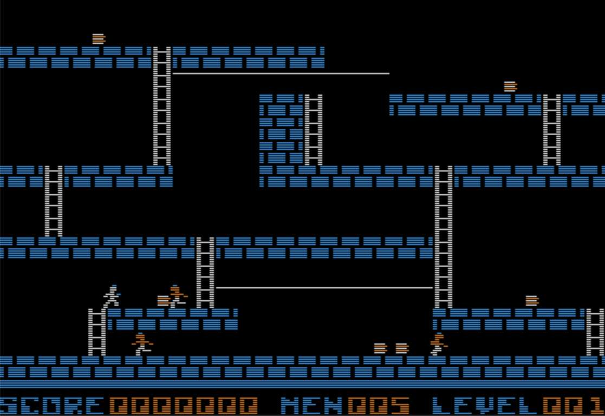</p>

<p align="center"><em>Lode Runner in a real game, played in <code>papple2</code>'s window from the original disk image (<code>make boot-lode-runner-throttled</code>).</em></p>

**Bandits** (Sirius Software, 1982, by the Ngo brothers) runs from Total Replay's ProDOS files, through a stand-in for ProDOS's MLI, from its cutscene into the game and on to Game Over. It has not been disassembled yet, and it is expected to be full of self-modifying code: the dream project in `DIRECTION.md`.

<p align="center">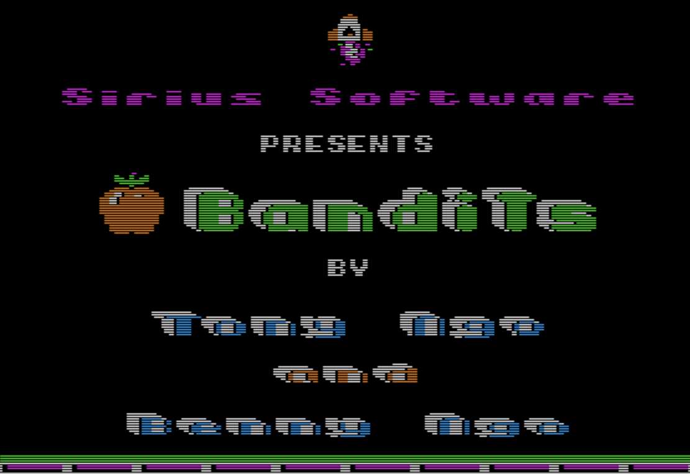</p>

<p align="center"><em>Bandits' title screen with the bandits and their scores, from Total Replay's files (<code>make boot-bandits</code>).</em></p>

**Robotron 2084** (Atari, 1983) was `papple2`'s first test case, researched in 2019 and 2020: the public project https://github.com/fschuhi/Robotron_2084, and a thread on 6502.org. It has not been completely disassembled either.

<p align="center">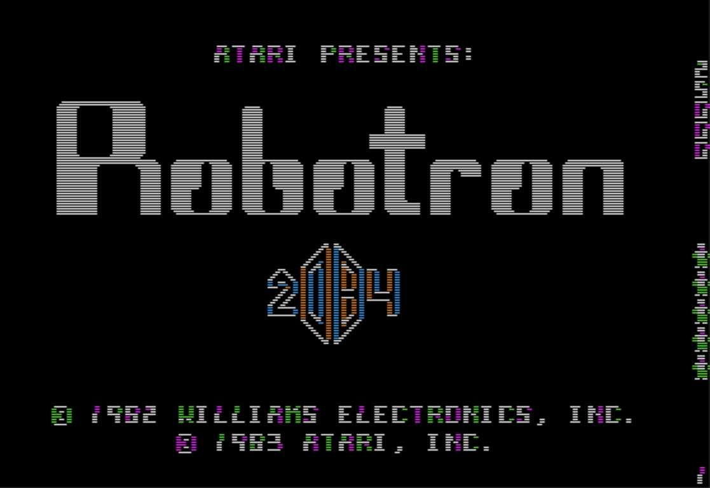</p>

<p align="center"><em>The Robotron 2084 splash screen, running through <code>make boot-robotron</code> -- <code>papple2</code>'s first test case.</em></p>

**More games:** Total Replay (by 4am and qkumba) ships many Apple II games as ProDOS files, loaded through the MLI, so the Bandits stand-in may serve many of them. Unchecked so far: how many need more MLI calls than Bandits, and how many need more than 48K (Total Replay itself targets 64K machines).

---

## The workbench

`papple2.workbench` is where the reverse engineering happens. You run a program with instrumentations attached, and they record what ran: `Tiling` which code ran and where it leapt, `StackTracking` which returns were real and which were tricks. They write their records as reports, plain files that carry meaning on their own, for you and for an LLM. The analysis reads the reports back and finds the routines, their basic blocks and their loops.

At the IPython prompt, the commands of `papple2.workbench.shell` show what was found: the routines, a routine's blocks, its callers, a graph of the routines, listings, a hexdump, a memory map. The same commands are the recipes of the experiments in `scripts/`. What you learn goes into the program's dossier, under git: labels, comments, hidden ranges and color ranges. Every later view shows them.

<p align="center">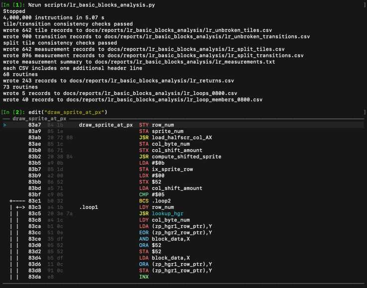</p>

<p align="center"><em>The experiment runs Lode Runner's attract play and finds its routines; <code>edit()</code> then opens one of them in the listing editor, with its labels and its loops as arrows.</em></p>

<p align="center">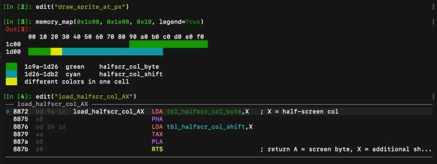</p>

<p align="center"><em><code>memory_map()</code> shows the color ranges given to two tables; in the editor, the operands that name them carry the same colors.</em></p>

<p align="center">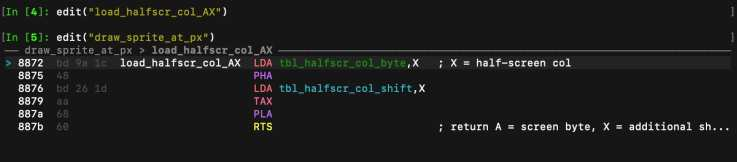</p>

<p align="center"><em>Enter on a <code>JSR</code> opens the routine it calls; the breadcrumb on top says where you came from.</em></p>

<p align="center">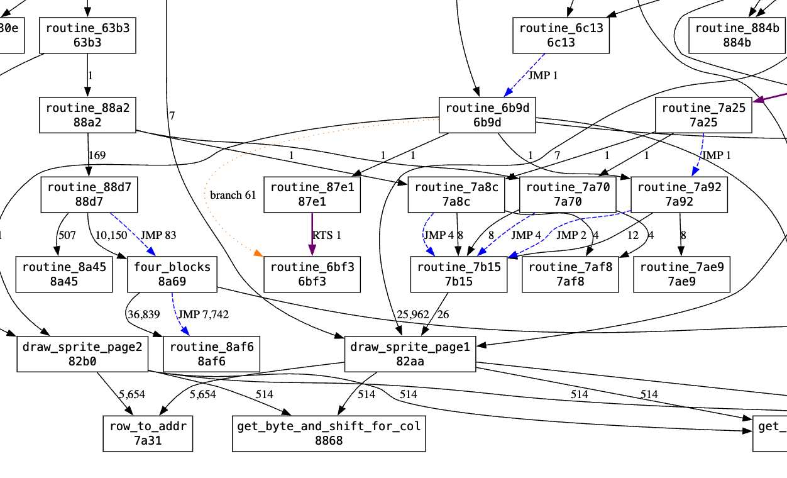</p>

<p align="center"><em>Part of the routine graph: calls with how often they were made, and the other ways into a routine, a <code>JMP</code> into its entry, a branch and an <code>RTS</code> used as a jump, each drawn in its own way.</em></p>

**The walkthrough** is the way in. Tiny programs, small enough to follow by hand, go through the whole pipeline in chapters, and each chapter is a test (`tests/test_walkthrough.py`), so it stays true. `make walkthrough-md` renders the chapters as a document, into `tmp/walkthrough/`.

<p align="center">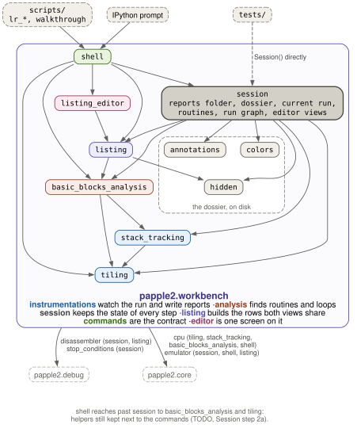</p>

See [`docs/workbench.md`](docs/workbench.md) for the commands, the experiments, the reports and the glossary.

---

## Architecture

The packages of `papple2`, and who imports whom:

<p align="center">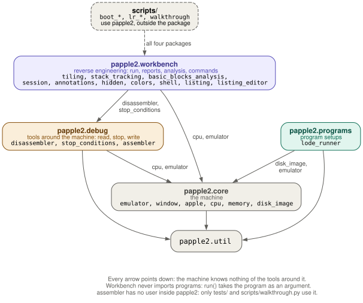</p>

`papple2.core` is the machine, and it never imports from the packages above it: the tools use the machine, never the other way round. `papple2.debug` is a toolbox around the machine: the disassembler reads it, the stop conditions stop it, the assembler writes programs for it. `papple2.programs` knows how to load and start one program: its `boot()` gives a ready emulator, e.g. Lode Runner loaded, with its stand-in for the disk routines installed. `papple2.workbench` holds the reverse-engineering tools. It never imports `programs`: `run()` takes the emulator a program's `boot()` gives. Programs that use `papple2` live outside the packages: the boot scripts and experiments in `scripts/`, the tools in `tools/`, and the sibling projects below.

Inside the machine, `emulator` builds everything else and runs the loop; `apple` is the Apple II itself, with its display, speaker, soft switches, memory and CPU. Two references point back up, not as imports that run, but as objects held while the machine runs:

<p align="center">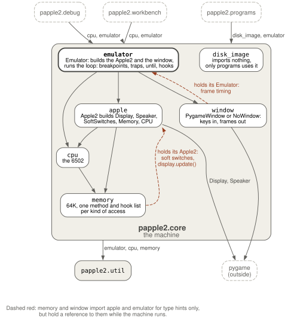</p>

The sources of these diagrams are the `.dot` files in `docs/diagrams/`; `make presentation` renders them, as SVG next to their sources for these pages, and as PDF and PNG into `tmp/presentation/`.

How the machine runs, its extension points, memory access by kind and the speed control: [`docs/architecture.md`](docs/architecture.md).

## Relation to sibling projects

**`a2-lode-runner`:** a private educational project to understand the Apple II game thoroughly, based on XekriRedmane's literate-source disassembly project published at https://github.com/XekriRedmane/lode_runner_reveng. All the levels are extracted and shown on one page: https://fschuhi.github.io/a2-lode-runner/levels.html. The first target is the level loader (`LOAD_LEVEL`, chapter 6). `make dasm-listing` there turns XekriRedmane's source into a listing `papple2`'s workbench can grade against.

**`a2-hires-lab`:** a standalone Excel/VBA lab exploring Apple II hi-res graphics mechanics, built around Chapter 3 of the `a2-lode-runner` disassembly. No shared code or repo with `papple2`. Its NTSC color decision table, once verified by hand against the chapter's worked examples, is meant to become test fixtures for `papple2`'s hi-res renderer, `Display.update_hires`.

**`probotron`:** my private project with the Robotron 2084 disassembly and its Excel/PyXLL workbench. It holds its own copy of `papple2`, from the tag `pre-redesign`, so it doesn't depend on this repo. Its public predecessor: https://github.com/fschuhi/Robotron_2084. `scripts/boot_robotron.py` remains here as `papple2`'s own manual check of the with-window path.

---

## Testing strategy

`papple2` is tested in three ways:

- **Automated (`make test`).** The pytest suite, always headless: the 6502 and its quirks, the Apple II's soft switches, display memory and disk image, headless runs with traps and `until`, the state machine, the throttle, the assembler and disassembler, the workbench's analyses, the dossier, and the shell's commands.
- **The walkthrough's chapters (`tests/test_walkthrough.py`).** Part of the same suite, but written to be read: tiny programs through the whole pipeline, each chapter a test that checks one step's output row by row, with comments that say why each row is what it is. `make walkthrough-md` renders them as a document.
- **Manual, with a window (`make boot-basic`, `make boot-robotron`, `make boot-lode-runner`, `make boot-bandits`).** Plain scripts in `scripts/`, for a human watching: the Monitor and Integer BASIC through the text page, Robotron through hi-res, Lode Runner and Bandits through their disk stand-ins, so the traps get checked too. They assert nothing, and `make test` never opens a window.

<p align="center">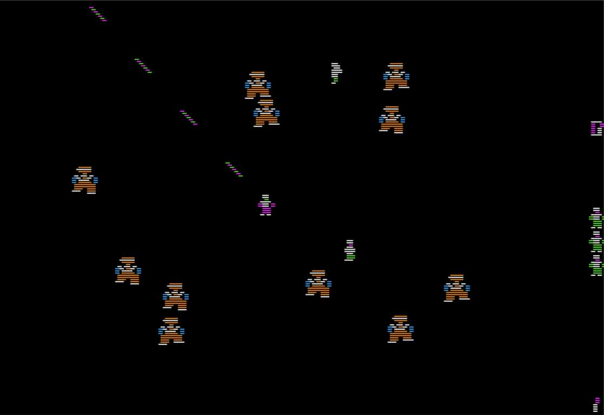</p>

<p align="center"><em>Execution stopped mid-game via <code>Ctrl-X</code> -- the status bar shows the halted CPU state, the same inspect point <code>Emulator.run(until=...)</code> and unserved traps stop at.</em></p>

---

## Data files

`papple2` needs Apple II binaries, a disk image and Total Replay files, none of which can be distributed in this repo. Where to get them, and where to put them: [`docs/data-files.md`](docs/data-files.md).

---

## Scripts & Experiments

The tools interacting with `papple2` live in the `scripts/` folder and generally fall into two categories:

- **The `boot_*` scripts:** Manual, visual checks that boot the emulator with a specific game or ROM payload attached to the pygame window. These are test-bed wrappers used for visual verification (`boot_basic.py`, `boot_robotron.py`, `boot_lode_runner.py`, `boot_bandits.py`). Lode Runner's setup (the load at `$0800`, the stand-in for its disk routines) lives in `papple2.programs.lode_runner`; `boot_lode_runner.py` runs it in a window or headless.
- **The `lr_*` experiments and `walkthrough.py`:** headless experiments on Lode Runner's attract play, and the walkthrough's tiny programs through the same pipeline. See [`docs/workbench.md`](docs/workbench.md), "Experiments in `scripts/`".

---

## Running

```bash
make setup    # create the venv (Python 3.12), install dependencies in editable mode
make test     # run the pytest suite
make boot-robotron  # boot Robotron with the pygame window open
make boot-basic     # boot Apple II into the Monitor; Ctrl-B enters Integer BASIC
make boot-lode-runner           # boot Lode Runner with the pygame window open; a key press starts a real game from the disk image
make boot-lode-runner-throttled # the same, at the speed of a real Apple II
make boot-lode-runner-headless  # run Lode Runner headless; save both hi-res pages as PNG
make boot-lode-runner-break     # the same with the window, stopped after 4,000,000 instructions, where the experiments end; Ctrl-X continues
make boot-bandits               # boot Bandits from Total Replay's ProDOS files
make lr-count        # Early experiment (frozen): map which addresses Lode Runner's attract play runs (PNG and HTML)
make lr-basic-blocks-analysis  # Every routine of the run; tiling, returns and loop reports (start 0800) in docs/reports/lr_basic_blocks_analysis/
make lr-current      # IPython with the run from the committed reports; overview, routines and listing into docs/reports/lr_current/
make walkthrough     # nested_loops through tiling and the basic blocks analysis, reports in tmp/walkthrough/nested_loops/
make walkthrough-md  # The walkthrough's chapters as a document, tmp/walkthrough/walkthrough.md
make ipython         # IPython in the venv; then e.g. %run scripts/lr_basic_blocks_analysis.py
make presentation    # Render the diagrams: SVG next to docs/diagrams/*.dot, PDF and PNG into tmp/presentation/
```

`make setup` will happily produce a broken install if your default `python3` resolves to 3.14. If needed: `rm -rf .venv && python3.12 -m venv .venv && make setup`.

<p align="center">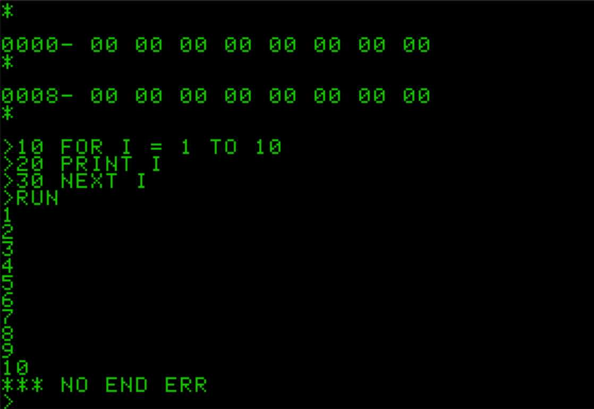</p>

<p align="center"><em><code>make boot-basic</code>, then <code>Ctrl-B</code> into Integer BASIC, running a small hand-typed program -- the real ROM, not a simulation of it.</em></p>
