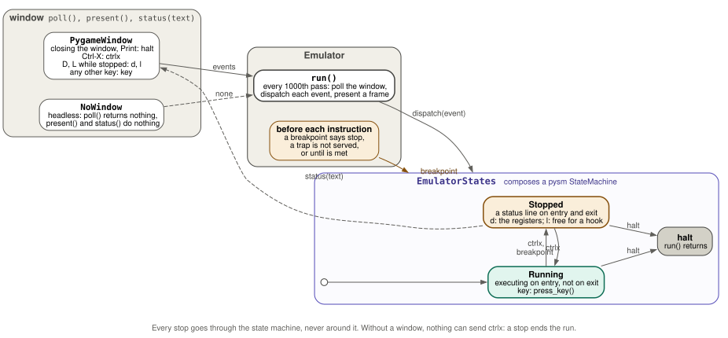
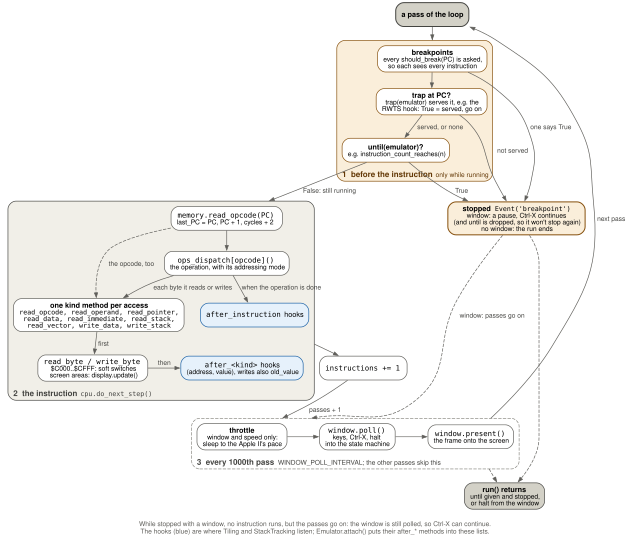

# papple2 -- Architecture

How the machine inside `papple2` runs, and the ways to act on a running program. The packages and the workbench are in [`README.md`](../README.md).

## Emulator / Window / States

`Emulator.run` never touches pygame directly: it polls a `Window`, dispatches whatever comes back to `EmulatorStates`, and lets `EmulatorStates` decide what that means:

`PygameWindow` and `NoWindow` share the same three methods (`poll`, `present`, `status`), so `Emulator` doesn't know or care whether a window exists. A breakpoint, an unserved trap, or an `until` condition passed to `run` dispatches the `breakpoint` event, which takes the same transition as `ctrlx`, so `Running` -> `Stopped` always goes through the state machine, never around it.

## Extension points

`papple2` has a few deliberately small ways to act on a running program. The reasoning behind them is in [`instrumentation-design.md`](instrumentation-design.md).

- **Hooks** (lists in `Memory` and `CPU`) watch every instruction and memory access, and experiments attach to them by method name; see "Memory access by kind" below.
- **Traps** (`add_trap(address, handler)`) stand in for a routine at a fixed address. Before each instruction, `run()` looks up `PC` in the trap table (only while there are any traps). A handler returns whether it *served* the address: `True`, and the run continues at whatever `PC` the handler set; `False`, and the run stops before the instruction there, via `breakpoint`. The two disk stand-ins, `RwtsHook` (Lode Runner, `$B7B5`) and `MliHook` (Bandits, `$BF00`), are traps.
- **`until`** is a parameter of `run()`, not an attachment point: a condition checked before each instruction (`instruction_count_reaches(n)`, `at_address(a)`). When it is met, `run()` stops via `breakpoint`; without a window it then returns, with a window it pauses as if Ctrl-X had been pressed. The ready-made conditions are in `papple2/debug/stop_conditions.py`.
- **Debug-key handlers** (`EmulatorStates.stopped_state`/`running_state`) are keyed to the window's events, not to instructions: `D` and `L` while Stopped. `tests/test_emulator_debug_keys.py` shows how to attach one from outside.

One pass of `Emulator.run()`: the breakpoints, the trap and `until` before the instruction, the instruction with its memory accesses and hooks, and the window's turn every 1000 passes.

## Memory access by kind

The CPU reads and writes memory through one `Memory` method per kind of access: `read_opcode`, `read_operand`, `read_pointer`, `read_data`, `read_immediate`, `read_stack` and `read_vector` for reads, `write_data` and `write_stack` for writes, plus three 16-bit reads built from them (`read_operand_word`, `read_pointer_word` with the 6502's page wrap, `read_vector_word`). The name says why the CPU accesses a byte, not where the byte is: `LDA $0100,X` touches the stack page, but it is a data read. Each method passes the access on to the shared `read_byte`/`write_byte`, where the soft switches and the display stay. Each method then calls the hooks in its own list (`after_read_opcode` ... `after_write_stack`); see `docs/instrumentation-design.md`, section 3.

`CPU` counts its instructions in `instruction_count` (zeroed like `cycles`, in `__init__` and `reset()`) and, at the end of each instruction, calls the hooks in `after_instruction`. These hooks get no arguments: they read `instruction_count`, `last_PC` and `last_opcode` from the `CPU`, so an experiment keeps the `CPU` it watches in `self.cpu`. See `docs/instrumentation-design.md`, section 4.

An experiment is a plain object whose methods are named after the hook lists. `Emulator.attach(experiment)` puts each such method into its list in `Memory` or `CPU`, and `detach(experiment)` takes them out again; both log one line at INFO. `scripts/lr_count.py` uses them for a map of what Lode Runner's attract play runs, as opcode, operand or immediate. The workbench's instrumentations use `after_instruction`: the tiling `papple2.workbench.tiling`, and the stack tracking `papple2.workbench.stack_tracking` (see "The workbench" in [`README.md`](../README.md)).

## Speed

Unthrottled, `papple2` runs as fast as Python allows, faster than a real Apple II. Windowed runs take a `speed` (`Emulator(speed=...)`): 1.0 is a real Apple II (about 1.023 MHz), `None` is unthrottled, and 1.0 is the default. Every 1000 loop passes, `run()` compares the cycles the CPU has counted with the wall-clock time and sleeps the difference; after a pause it measures afresh. Headless runs and tests are never throttled. `scripts/boot_lode_runner.py` passes `None` unless it gets `--speed`, so `make boot-lode-runner` runs at full speed and `make boot-lode-runner-throttled` at the speed of a real Apple II. The display is shown 40 times per second (`frame_rate`).
