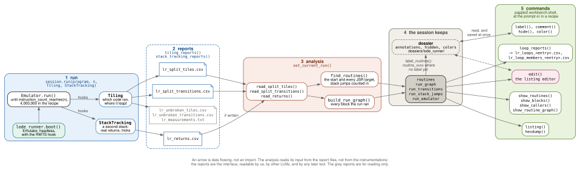

# papple2 -- Workbench

For the reverse engineer: the commands at the prompt, the experiments and the reports. `README.md` has the short version.

---

## Overview

`papple2.workbench` holds two kinds of modules, connected by files in a folder, and the tools for looking at what they found. All of it is used through commands, by experiments and at the prompt alike.

- **Instrumentation modules** watch a running `Emulator` through its hooks -- after every instruction, or after reads and writes of memory -- and write reports into a folder given by the caller. The `-ing` suffix marks them: `Tiling` in `tiling.py`; `StackTracking` in `stack_tracking.py`, a shadow stack that sorts every `RTS` by the frame its `JSR` opened and writes `lr_returns.csv`; `CrossReferencing` in `cross_referencing.py`, which counts every immediate, pointer and data access by the instruction that made it and writes `lr_xrefs.csv`. `run()` attaches any number of them, as classes it builds on the booted machine.
- **Analysis modules** need no `Emulator`: they read reports from a folder and return plain values or write reports of their own, so they also run on fixture files. Reading is kept apart from the logic. `basic_blocks_analysis.py` reads the split reports, builds a graph of basic blocks, finds dominators and natural loops, and writes the loop reports.
- **The shell** (`shell.py`) holds the commands: the functions meant for the prompt and for experiments. It keeps them in a `Session` (`session.py`), the one at `shell.session`: the current reports folder, dossier and run, one of each at a time. Each command is a thin wrapper that prints what the `Session` gives it. `listing_rows()` in `listing.py` builds a range from memory after the run, with labels in the operands and in a column of their own, comments at the end of each row, and the jumps the run took drawn as arrows in a gutter on the left; `listing()` shows the current run with the dossier's labels, comments, hidden ranges and location colors; `edit()` opens the same rows in the listing editor, with syntax colors instead of location colors (see "Color ranges"). `hexdump()` shows the memory as bytes, in their location colors, and text. Commands that show something return text, which IPython shows as `Out[n]` and keeps in `_`; `clip()` copies the plain text.
- **The dossier** is everything we know about one program, in a folder of its own: `dossiers/lode_runner/`, under git (unlike `data/`). It holds `annotations.json` for labels and comments, `hidden.json` for named hidden ranges, and `colors.json` for named color ranges. Each store reloads before a change and saves changes immediately; commands reload before showing their contents, so two IPython sessions can work on one dossier. `use_dossier()` opens all three stores and starts new annotations with the Apple II's standard labels. Opening the hidden and color stores writes nothing. Unlike the reports, which every run rebuilds, these definitions persist across runs. Labels given by hand stay; routine entries without a label receive a generated label when the run's routines are built. Snapshots (outside git) may follow.

<p align="center"></p>

`scripts/walkthrough.py` takes the walkthrough's three tiny programs through the same pipeline, each with a recipe of its own; `tests/test_walkthrough.py` reads them chapter by chapter. Everything the pipeline finds is observed structure: only what ran in this run.

Ranges are half-open throughout the workbench: a block printed as `6004-6007` holds the bytes `$6004` to `$6006`, its length is `end - start`, and the next block starts where it ends. Listings, hidden ranges and color ranges use the same convention.

## Experiments and recipes

An **experiment** is one `lr_` script in `scripts/`. Its **recipe** is the part that wires up the run and writes the reports: a few lines of commands, the same ones you could type at the prompt. The recipe of `lr_basic_blocks_analysis.py`, without its command-line arguments:

```python
use_reports_folder(Path("docs/reports/lr_basic_blocks_analysis"))
use_dossier(Path("dossiers/lode_runner"))
run(lode_runner.boot(), 4_000_000, Tiling, StackTracking)
tiling_reports()
stack_tracking_reports()
overview_reports()
loop_reports(0x0800)
```

The rest of an experiment can do analysis of its own, or offer functions of its own. A function that proves useful beyond its experiment graduates to `shell.py`, as `show_blocks()`, `listing()` and `loop_reports()` did from `lr_basic_blocks_analysis.py`.

`run()` only runs: it takes a ready emulator, as a program's `boot()` gives it, builds and attaches the instrumentations, runs from where `PC` stands, and detaches them. What gets written afterwards is the experiment's choice, one command per kind of report: `tiling_reports()` writes the tiling reports into the reports folder and builds the run's routines and run graph from them, since the files are the only connection. Each experiment writes into a reports folder of its own, `docs/reports/<experiment>/`, under git. The reports of other experiments are read by their full paths, by convention, as `lr_current.py` reads those of `lr_basic_blocks_analysis` and `lr_cross_reference`.

## At the prompt

The usual way in is to `%run` the experiment to work on, then use the commands:

```python
%run scripts/lr_basic_blocks_analysis.py
show_routines()
show_blocks(0x6238)
listing(0x7a3e)               # one argument: the whole routine
edit(0x7a3e)                  # edit the whole routine, i.e. add labels and comments
label(0x7a3e, "lookup_hgr")
listing("lookup_hgr")         # a label wherever a routine's address goes
show_ways_in("lookup_hgr")    # every way into it
hexdump("hgr_rows_lo")        # one page of memory, as bytes and text
clip()                        # the last output to the clipboard
```

`edit()` opens the listing editor, `papple2.workbench.listing_editor`, under the prompt; it disappears again when you leave with `q` or Esc. Enter on a `JSR` opens the routine it calls, Enter on a branch moves the bar to its target, Enter on a `JMP` or a branch into another routine opens that routine with the bar on the target, Backspace goes back and `f` forward again; the breadcrumbs in the rule above the listing show the routines followed into, followed by those `f` goes to. Every breadcrumb uses its assigned color, or gray without one; only the current breadcrumb is bold. `g` opens a picker with every routine of the run, to go to one; `u` opens it on every way into the routine shown (a `JSR`, a `JMP` or a branch, a glide, the `RTS` of a dispatch, a jump through a door), and Enter lands on it. Only the code the run executed is listed: every gap that never ran is one gray line, e.g. `... 0803-2800: 8,189 bytes never ran ...`. A routine that runs on into another one, without a jump, ends with a gray line that says where, e.g. `... runs on into PUT_STATUS_BYTE ...`; the bar stops on it, and Enter goes there. Named hidden ranges also collapse to gray rows. Tab edits the label of the bar's row and then that of the address its operand names, zero page included; `e` edits the row's comment; `c` copies the visible lines. Every change goes into the dossier at once. Each routine opens again as it was left, as long as the run lasts. The keys, Ctrl keys for editing included, are in the module's docstring.

What `%run scripts/lr_basic_blocks_analysis.py` leaves in the session:

| Kind | Names                                                                                                                                                         |
|---|---------------------------------------------------------------------------------------------------------------------------------------------------------------|
| Commands: setting up | `use_reports_folder()`, `use_dossier()`, `run()`, `tiling_reports()`, `stack_tracking_reports()`, `cross_referencing_reports()`, `overview_reports()` |
| Commands: the current run | `show_routines()`, `show_blocks()`, `show_ways_in()`, `show_xrefs()`, `show_routine_graph()`, `listing()`, `hexdump()`, `edit()`, `loop_reports()`        |
| Commands: the clipboard | `clip()`                                                                                                                                                    |
| Commands: the dossier | `label()`, `comment()`, `unlabel()`, `uncomment()`, `hide()`, `unhide()`, `color()`, `uncolor()`, `colors()`                                                      |
| Commands: range bounds | `to_range()`                                                                                                                                                 |
| Commands: hex arithmetic | `hx()`                                                                                                                                                        |
| Commands: memory map | `memory_map()`                                                                                                                                                |
| Commands on objects | `print_routines()`, `print_blocks()`, `print_edges()`, `print_loops()`, `listing_rows()`, `print_listing()`, `set_current_run()`                               |
| For a run of your own | `lode_runner.boot()` (a ready machine), `Tiling`, `StackTracking` and `CrossReferencing` (instrumentations, classes: capitalized)                              |
| Machinery | `shell`, and through it `shell.session` with `shell.session.run_emulator`, `.run_instrumentations`, `.routines`, `.run_graph`, `.run_transitions`, `.annotations`, `.hidden`, `.color_store` |
| The experiment's own | `REPORTS_FOLDER`, `DOSSIER`, `parse_arguments()`, `arguments`, `entry`, `argparse`, `Path`                                                                    |

The commands are the contract: documented here, and kept working. The machinery is there for debugging and curiosity, with no guarantee. Reach it through the session, as `shell.session.routines`. A copy keeps the value it had: after `routines = shell.session.routines`, the next `run()` builds new routines and your name still holds the old ones. The `Session` itself always stays current.

## Hiding ranges

Hide a span that is not useful to read, including code that ran but was overwritten afterwards:

```python
hide("relocation_bytes", "relocation_loop", 0x2832, "overwritten after it ran")
listing("routine_0800")
edit("routine_0800")
```

Both views replace the span with:

```text
... 2800-2832 relocation_bytes: overwritten after it ran ...
```

- `hide(name, start, end, note)` saves the definition in the current dossier's `hidden.json`. Bounds are addresses or labels; end is exclusive. No run is required to save explicit bounds.
- Reusing a name replaces its definition. Overlaps with other hidden ranges are refused; adjacent ranges are allowed.
- `unhide(name)` removes the definition. An unknown name is refused.
- A listing clips hidden spans to its requested bounds and omits them before decoding. Hiding takes precedence over gaps that never ran.
- The editor displays the collapsed row in gray and skips it when moving the bar.
- Labels and comments inside the span remain in the dossier but are not displayed. Arrows with hidden ends are dropped; arrows passing across the span remain.
- The run graph is unchanged. When hiding code, place the bounds between instructions.

## Color ranges

Assign colors to address spans to identify related code or data:

```python
color("sprites", *to_range("r_11x2_1"), "blue")
color("hgr_lookup", *to_range("lookup_hgr"), "cyan")
colors()
edit("r_11x2_1")
listing(0x82aa, 0x84c1)
```

`to_range("r_11x2_1")` returns the routine's existing listing bounds as a tuple. Python's `*` unpacks its two elements into the start and end arguments of `color()`.

- `color(name, start, end, shade)` saves a definition in the current dossier's `colors.json`. Bounds are half-open addresses or labels. A single byte is a range with `end = start + 1`.
- `to_range(routine)` returns the current routine's lowest block start and highest block end, including the intervening gaps. `to_range(start, end)` resolves explicit address or label bounds without requiring a run.
- Saved color bounds are addresses, not references to routine names. Later runs and label changes do not resize them.
- Reusing a name replaces its definition. `uncolor(name)` removes it; an unknown name is refused.
- `colors()` shows saved definitions in address order.
- Supported shades are `red`, `green`, `yellow`, `blue`, `magenta`, `cyan` and `white`.
- Overlaps are allowed. At one byte, matching definitions with the same shade retain that shade; different shades produce the mix color, light yellow (`brightyellow`), which no range can be given. With no matching definition, no color is assigned.

The views share the lookup but use colors differently:

- **`listing()` colors location.** Each addressed row uses the color at its starting address, covering address, bytes, label and instruction, including the operand and `.byte` contents. Comments, arrow gutters and collapsed rows retain their normal appearance. A long listing can show classified ranges in the context of surrounding code.
- **`edit()` colors the navigation path.** A breadcrumb uses the color of definitions containing the routine's whole displayed span. Different containing shades produce the mix color; partial coverage alone does not color the title. Past, current and future names all use their assigned colors; only the current one is bold. Uncolored names, separators and abbreviations are gray. Instruction lines are not location-colored.
- **`edit()` colors syntax and targets.** Each mnemonic has the color of its class, as in the 6502 reference at pagetable.com: load, trans, stack, shift, logic, arith, inc, ctrl, bra, flags, nop. The hex bytes are dark gray. The name in an operand has the color of the address it names (`ListingRow.target`): the table in `LDA tbl,X`, the pointer in `STA (ptr),Y`, the target of a `JSR` or a branch. Brackets, index, immediates, labels and comments stay plain.
- **`hexdump()` colors bytes.** Each hex byte uses the color at its own address. The text column stays plain, read like a comment.
- **`memory_map()` colors cells.** `memory_map(start, end, cell_bytes)` shows 16 cells per row, each `cell_bytes` bytes, a power of 2: by default the whole 64 KB, a page per cell; `cell_bytes=0x10` makes each row one page. A cell has the color of the bytes in it, even if only some of them are classified; different colors in one cell give the mix color. Rows start at round addresses, columns show offsets, and there are no gridlines, so neighbouring cells of one color form a band. A legend below lists the color ranges in the range shown; `legend=False` leaves it out. No run is needed.
- **`show_routine_graph()` colors routines.** A routine gets a thick border in the color of the definitions containing its whole span, by the same lookup as the breadcrumbs; partial coverage alone gives no border, and neither does the mix color, which Graphviz cannot draw. The arrows keep their own colors, which name the way into a routine: a call, a `JMP`, a branch, a glide or a stack jump.
- **Clipboard text stays plain.** `listing()` and `hexdump()` return a `Text` string with plain content and a separate colored display version for IPython. `str()`, `splitlines()` and `clip()` use the plain content. `memory_map()` does the same; its plain content shows a letter per colored cell (`g` for green, `Y` for the mix) and dots for the others.

Operand colors in `listing()` are not implemented yet. A breadcrumb's whole-span containment lookup is not a summary of byte colors for a map cell.

## Cross references

A cross reference (xref) links an instruction to a byte it touched, with the kind of access. The words are in [`glossary.md`](glossary.md), section 5. `CrossReferencing` counts the xrefs while the program runs. To have them, attach it, and afterwards call `cross_referencing_reports()`: it writes `lr_xrefs.csv` into the reports folder and keeps its rows for `show_xrefs()`. The walkthrough's `memory_tour` does both:

```python
%run scripts/walkthrough.py memory_tour
show_xrefs(0x06)
```

```text
instruction_address  code         kind          effective_address  bytes    count  indexes
600d                 STA $06      write_data    0006-0007              1        1  -
6015                 LDA ($06),Y  read_pointer  0006-0008              2        2  -
6015                 LDA ($06),Y  read_data     0301-0302              1        1  01-02
```

- `show_xrefs(target)` takes an address or a label, and lists every access made by an instruction whose operand names it. The code is shown as the run left it in memory, with the dossier's labels.
- Lines of one instruction and one kind are merged where their effective addresses follow each other without a gap. `bytes` is how many bytes the line covers, `count` how often they were touched, `indexes` the values of `X` or `Y` that were added, as half-open ranges.
- In the example: the `STA` that builds the pointer, the pointer's two bytes read by `LDA ($06),Y`, and the byte it reached, `$0301`, with `Y` = 1. The data row has the pointer as its target, however far away the byte is.
- `show_xrefs(target, raw=True)` prints the rows as they were recorded: one line per effective address, with the values seen.
- Four kinds are counted: `read_immediate`, `read_pointer`, `read_data` and `write_data`. Opcode and operand fetches are not counted, since `Tiling` knows what ran; neither are stack and vector accesses, since `StackTracking` keeps the stack. The report's columns are described in the docstring of `papple2.workbench.cross_referencing`.
- Observed, not proven: the xrefs say what this run did. An instruction that writes into its own operand, such as `INC *+1`, has its write counted under the new target.

For Lode Runner, `lr_cross_reference.py` writes the attract play's report into `docs/reports/lr_cross_reference/`, and `lr_current.py` loads it together with the routines (see "Experiments in `scripts/`"). Next to the report lie `lr_xrefs_629c.csv` and `lr_xrefs_6fa6+6fb0.csv`, the rows of single instructions, as examples that are easier to read than the whole report; and the digest `lr_xrefs_compressed.csv`, which `make xrefs-compress` makes: the merging of `show_xrefs()`, for every row of the report. `make xrefs-overview` prints the accesses per kind, and the instructions, the instruction and target pairs, and the memory pages with the most rows.

`edit()` and `listing()` do not show xrefs yet. Brushing, in [`ui-ideas.md`](ui-ideas.md), builds on them.

## Experiments in `scripts/`

- **The `lr_*` experiments:** headless experiments on Lode Runner's attract play, each with a reports folder of its own (see "Experiments and recipes" above).
  - `lr_basic_blocks_analysis.py`: written as a recipe; every routine of the run, the tiling reports, the stack tracking's `lr_returns.csv`, the loop reports of `$0800` (more with `--loop-reports`), and the overview with labels (`lr_overview.txt`, `lr_routines.csv`, `lr_listing.tsv`) into `docs/reports/lr_basic_blocks_analysis/`, under git. Made for `%run` in IPython as well, where it opens Lode Runner's dossier.
  - `lr_cross_reference.py`: written as a recipe; the cross reference of the attract play, `lr_xrefs.csv`, into `docs/reports/lr_cross_reference/`, under git, with only `CrossReferencing` attached. Its `xref_summary()` prints the report's size, its rows and accesses per kind, and the rows on the hi-res pages. The recipe opens Lode Runner's dossier; `show_xrefs("tbl_hx_byte")` then shows every instruction that names the address as its operand, its rows merged into one line wherever their effective addresses follow each other without a gap.
  - `lr_current.py`: the current run without a new analysis. It runs the attract play without instrumentations, only for the memory, and builds the run from the committed reports of `lr_basic_blocks_analysis` and `lr_cross_reference`, so `edit()` and `show_xrefs()` work in one session. It writes the overview with today's labels into `docs/reports/lr_current/`: `lr_overview.txt` (the whole run, the routines with their callees, the blocks in no routine, the loops), `lr_routines.csv` (the routines, for Excel) and `lr_listing.tsv` (every routine's listing, one after the other). `make lr-current` opens IPython with it.
  - `lr_grade.py`: no run. It builds the routines from the committed reports of `lr_basic_blocks_analysis`, as `set_current_run()` does, checks that they are the routines of its `lr_routines.csv`, and grades them against `docs/lr_answer_key.csv`: how many of Xekri's subroutines have a routine with exactly their blocks, and which routines hold the blocks of the others. The key only grades; nothing in it goes into the tools. `make lr-grade`.
  - Early experiments, frozen: written before the recipes, with run code of their own, writing into `tmp/`. Kept as they are, as reminders and placeholders. `lr_count.py`: a 256x256 map of the memory, one cell per address, showing which addresses ran as opcode, operand or immediate (PNG and HTML).
- **The xref scripts:** `compress_xrefs.py` (`make xrefs-compress`) makes the digest `lr_xrefs_compressed.csv` from `lr_xrefs.csv`; `explore_xrefs.py` (`make xrefs-overview`) prints an overview of `lr_xrefs.csv`. See "Cross references".
- **`walkthrough.py`:** one of the walkthrough's programs (`nested_loops`, `rts_dispatch`, `memory_tour`) through the whole pipeline, reports into `tmp/walkthrough/<program>/`; made for `%run` in IPython, and the model for `tests/test_walkthrough.py`.

## Glossary

The words: [`glossary.md`](glossary.md).
